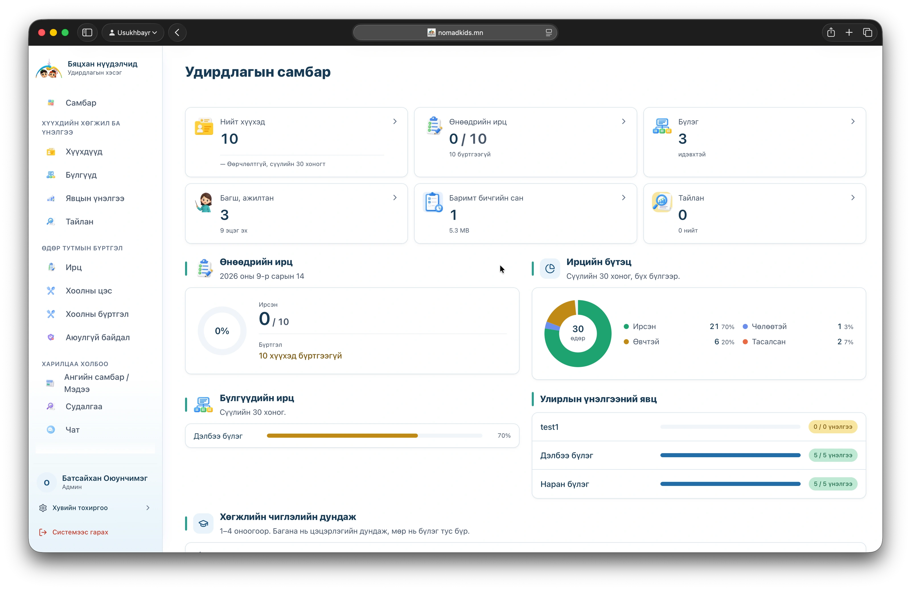
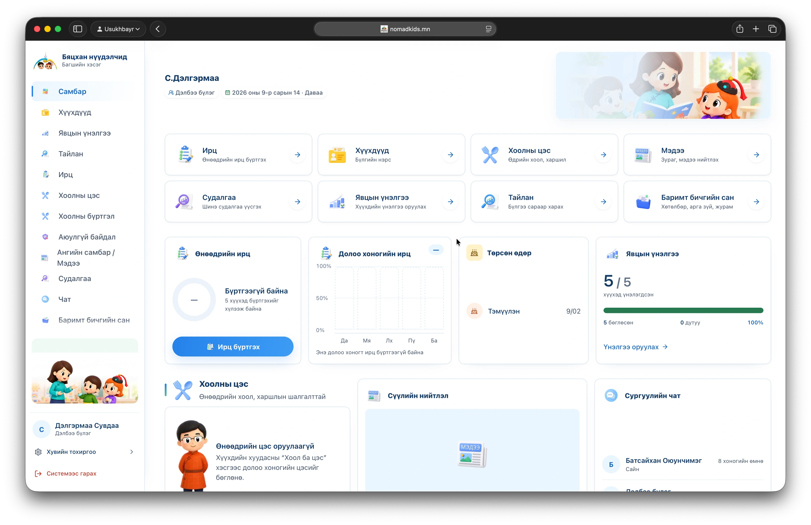
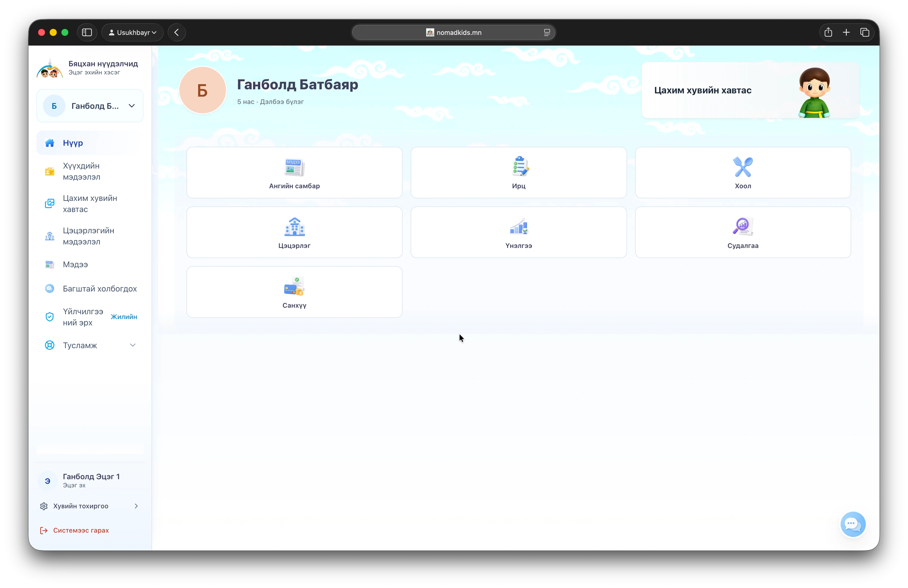

# 🧸 NomadKids

A kindergarten child-development portfolio platform, live in production and integrated with Mongolia's national education system.
Цэцэрлэгийн хүүхдийн хөгжлийн цахим портфолио систем.

**Live:** [nomadkids.mn](https://nomadkids.mn)

## What it does
- Teachers record each child's development and assessments
- Parents follow their own child's progress and photos
- Separate views for directors, teachers, cooks, accountants and parents
- Each child's history exports as a printable PDF

## Stack
    

---

The source code is private. Built by [Usukhbayar](https://usukhbayar.dev).
